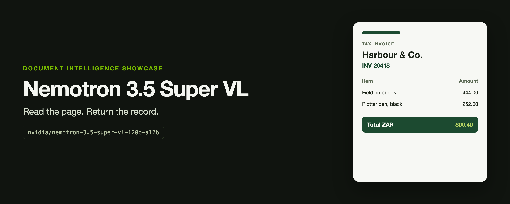

# Nemotron 3.5 Super VL

A Colab notebook for document intelligence on [NVIDIA NIM](https://docs.api.nvidia.com/nim/reference/nvidia-nemotron-3_5-super-vl-120b-a12b). The model is `nvidia/nemotron-3.5-super-vl-120b-a12b`. It reads a page image and returns the record.

[](https://colab.research.google.com/github/cobusgreyling/nemotron-3.5-super-vl/blob/main/notebooks/document_intelligence.ipynb)

Super VL is the vision-language specialist in the Nemotron lineup: one model for the page, the tool call, and the answer. This repo shows that on three synthetic documents.

| Page | File | What the notebook checks |
| --- | --- | --- |
| Tax invoice | [test_data/invoice.png](test_data/invoice.png) | Vendor, dates, both lines, VAT, and total |
| Till receipt | [test_data/receipt.png](test_data/receipt.png) | Basket, total, and the VAT already included |
| Return form | [test_data/return_request.png](test_data/return_request.png) | Read the form, call `lookup_return_policy`, then decide |

The return window is not printed on the form. It is in [test_data/policies.json](test_data/policies.json). A correct decision has to use the tool. Expected result: apparel, 24 days since purchase, a 30-day window, eligible.

## Run it in Colab

1. Open the notebook with the badge above.
2. In Colab, add a secret named `NVIDIA_API_KEY`.
3. Run all cells.

The first code cell clones this repo when the test pages are not already next to the notebook. From a local checkout, run the notebook with the repo as the working directory, or from `notebooks/`.

```bash
pip install -r requirements.txt
export NVIDIA_API_KEY=your-key
```

The key stays in the environment or the Colab secret. Nothing in this repo stores one.

Calls go to `https://integrate.api.nvidia.com/v1/chat/completions`. Vision sampling follows the model card: temperature `0.6`, top_p `0.95`, reasoning off.

## What a local run returned

On 16 October 2026 the hosted endpoint matched [test_data/ground_truth.json](test_data/ground_truth.json):

- Invoice: 14/14 fields
- Receipt: 9/9 fields
- Return form: one call to `lookup_return_policy` with `apparel`, then 5/5 decision fields

Hosted responses can change. The notebook prints every field that does not match.

## Test data

The pages are fictional. `scripts/make_test_data.py` draws them and writes the ground truth. It uses the Arial and Courier New fonts shipped with macOS. The committed PNGs are the fixtures Colab uses, so you do not need to regenerate them to run the notebook.

## Scope

This is an independent showcase. It is not an NVIDIA project. The notebook and the synthetic pages are MIT. Use of the model follows NVIDIA's terms for the NIM endpoint and the model license.
